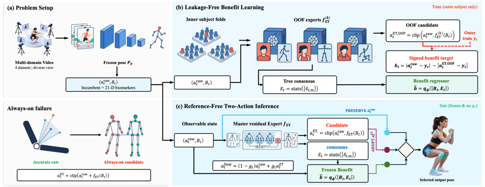

This work, **first-authored by undergraduate researcher Jun Ho Lee**, has been accepted to the **WACV 2027 Main Conference (Application Track)**. The authors are Jun Ho Lee, Dongjun Kang, and Kyungsu Lee.

The proposed selective calibration method learns whether to preserve an existing monocular kinematic estimate or adopt an ExtraTrees correction. It achieves a macro MAE of **5.94°** and reduces preservation failure at a 5° tolerance from **34.7% to 16.5%**.

### Selective Calibration Framework

*Figure 2 from the paper. Subject-disjoint training and forest consensus features support benefit prediction, allowing reference-free correction decisions at inference.*
