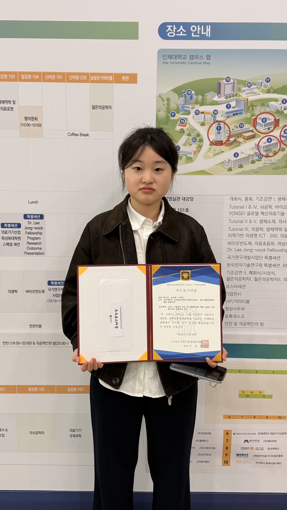
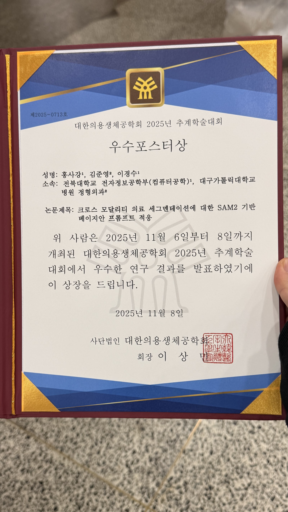

축하합니다!

MacsLAB 석사과정 <strong>홍사강</strong> 학생이 <strong>대한의용생체공학회 2025년 추계학술대회</strong>에서
<strong>우수포스터상</strong>을 수상했습니다.

이번 수상은 2025년 11월 6일부터 8일까지 인제대학교(김해)에서 열린 학술대회에서
우수한 연구 성과를 인정받아 이루어진 성과입니다.

*대한의용생체공학회 2025 추계학술대회 수상 현장*

*홍사강 학생 우수포스터상 상장*

수상 논문 정보:

- <strong>홍사강(1저자), 김준영, 이경수(교신저자)</strong>
- <strong>크로스 모달리티 의료 세그멘테이션에 대한 SAM2 기반 베이지안 프롬프트 적응</strong>
  (SAM2-based Bayesian Prompt Adaptation for Cross-Modality Medical Segmentation)

홍사강 학생의 수상을 진심으로 축하하며,
앞으로도 MacsLAB의 뛰어난 연구 성과가 계속 이어지길 기대합니다.

관련 링크:
- [/publication/0034-sam2-based-bayesian-prompt-adaptation-for-cross-modality-medical-segmentation/](/ko/publication/0034-sam2-based-bayesian-prompt-adaptation-for-cross-modality-medical-segmentation/)
- [대한의용생체공학회 2025 추계학술대회 프로그램](https://www.kosombe.or.kr/register/2025_fall/program/sub07.html)
